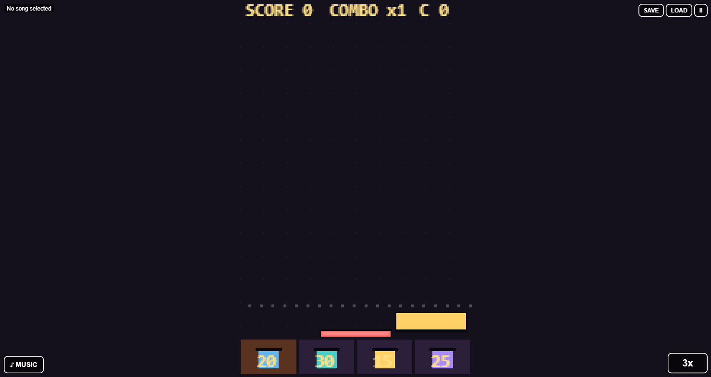

# STACK TAP — Android Edition

A simple, addictive one-tap leisure game. Tap to drop the moving block onto the tower; land it cleanly, build a combo, and see how high you can stack.

## Install
Copy `DOOMQR.apk` to an Android 5.0+ phone, allow **Install unknown apps**, and install. Portrait only, fully offline.

## How to play
- Tap anywhere on the play area to drop the moving block.
- Overlapping the block below grows your tower; a perfect drop gives bonus coins and a combo.
- A miss ends the run unless you have a shield.
- Speed increases as you stack higher.
- `Space` drops, `1`–`4` select boosters, `P`/`Esc` pauses.

## Boosters
Spend coins on four boosters at the bottom: **SLOW** (20) halves block speed for 5 drops, **WIDE** (30) widens the block, **x2** (15) doubles score for 5 drops, **SHIELD** (25) saves you from one miss.

## Features
Title and pause screens, save/load, high scores, achievements, daily challenge, unlockables, music picker with looping playback and volume, haptics, sound effects, and hold-to-`3x` fast forward.

## Build
Android SDK platform 34 + build-tools 34.0.0, then `.\DoomQR-Android\build.ps1`.

Credits: Android app and game by Ashish; original URL-game experiments by Siddhant Dubey.
