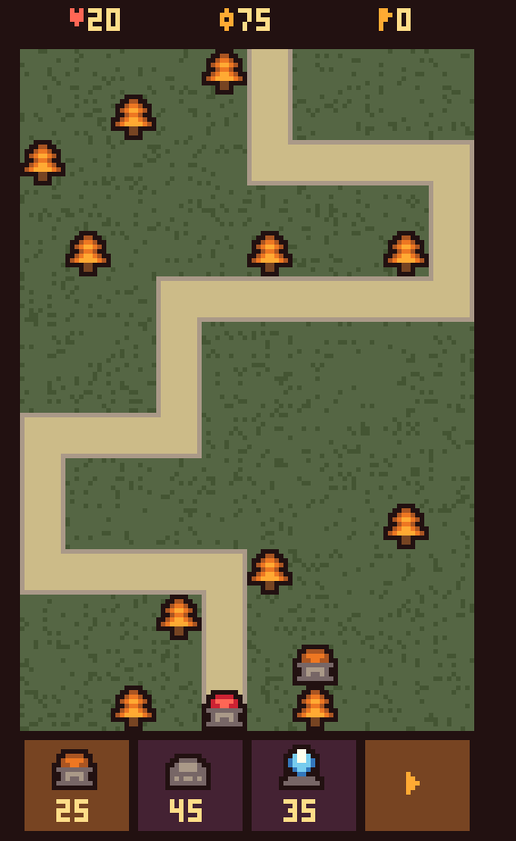

# DOOM.QR — Android Edition

A portrait, top-down tower-defence game rebuilt to match the supplied reference screenshot. It keeps the full extended feature set: four placeable weapons, upgrades, five enemy types plus a boss, growing map, score/combo, saves, music and more.

## Install
Copy `DOOMQR.apk` to an Android 5.0+ phone, allow **Install unknown apps**, and install. Runs completely offline. Portrait only.

## How to play
- **Place a tower:** tap one of the four cards at the bottom, then tap free grass. Towers cannot go on the road, trees or another tower.
- **Start a wave:** tap the orange arrow card (or press `Space`). Enemies follow the beige road toward your red base at the bottom.
- **Upgrade:** tap a placed tower to upgrade it (cost 15 + 15 per level, max level 5).
- **Lives:** heart counter at top-left. Enemies reaching the base cost 1 life, bosses cost 5.
- **Coins:** yellow counter. Earned from kills and wave bonuses; spent on towers/upgrades.
- **Kills:** third counter at top.
- `1`–`4` select a tower, `Space` start wave, `P`/`Esc` pause.

## Towers ("weapons")
| Card | Cost | Role |
| --- | --- | --- |
| FIRE | 25 | Ground, splash damage |
| ROCK | 45 | Heavy ground damage, slow fire rate |
| ICE | 35 | Air + slows enemies |
| MISSILE | 55 | Air/ground homing splash |

## Enemies and waves
Imp, flyer, swarmer, armoured brute and sniper, with a boss every 5th wave. Each wave grows larger and tougher. Every 3 waves the fog lifts to expose more of the map. Combos multiply your score up to ×9.

## Features carried over
Title/pause screens, music file picker with looping playback and volume, save/load, high scores, achievements, daily challenge, unlockables (bonus coins at wave 5, upgraded missile at wave 10), haptics, sound effects, minimap, and hold-to-3x fast forward (skips redundant draws).

## Build
Android SDK platform 34 + build-tools 34.0.0, then `.\DoomQR-Android\build.ps1`.

Credits: original DOOM.QR by Siddhant Dubey (GPL-2.0); Android rebuild with gameplay extensions.
